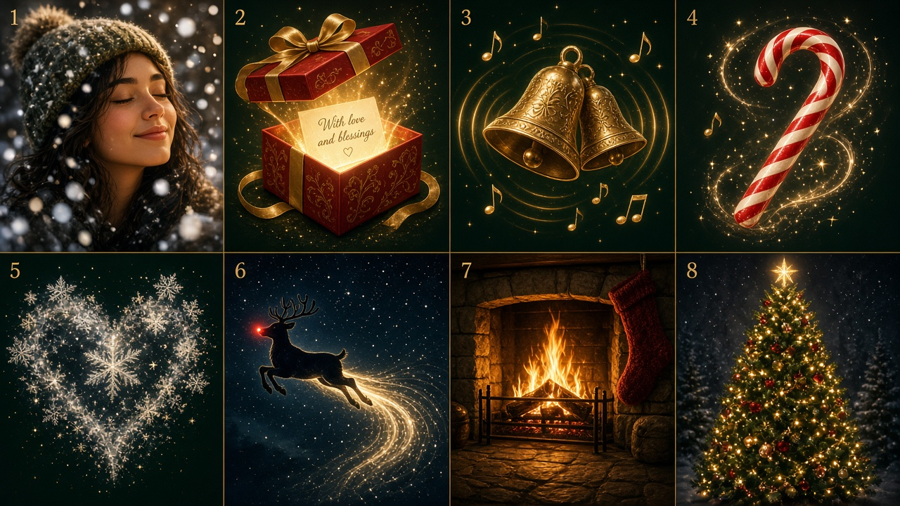

# 🎄 雪夜祝福 · Snow Night Mirror

浏览器圣诞摄像头互动：像素风手势特效 + 可定制礼物祝福链接。

**🌐 在线体验：** https://wsf1202.github.io/snow-night-mirror/

## ✨ 效果预览

<div align="center">



</div>

**定稿分支：** `cursor/christmas-camera-hci-1f8e`  

**完整复刻规格（必读）：** [`docs/RECREATE.md`](./docs/RECREATE.md)  
**手势速查：** [`docs/GESTURES.md`](./docs/GESTURES.md)

## 本地开发

```bash
npm install
npm run dev
```

打开 http://127.0.0.1:5173/ （需允许摄像头）。

定制页：http://127.0.0.1:5173/customize.html

## 构建

```bash
npm run build
npm run preview
```

## 🎮 手势速查

| 特效 | 手势 | 预览 |
|------|------|------|
| ❄️ 飘雪 | 五指张开 |  |
| 🔔 铃铛 | 拇食捏合轻摇 |  |
| 🎅 圣诞帽 | 比 1 |  |
| 🦌 鹿角 | 比 2 |  |
| 🎄 圣诞树点灯 | 比 3 |  |
| 🎁 礼物 | 双手比心 |  |
